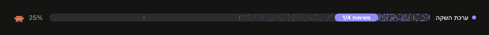
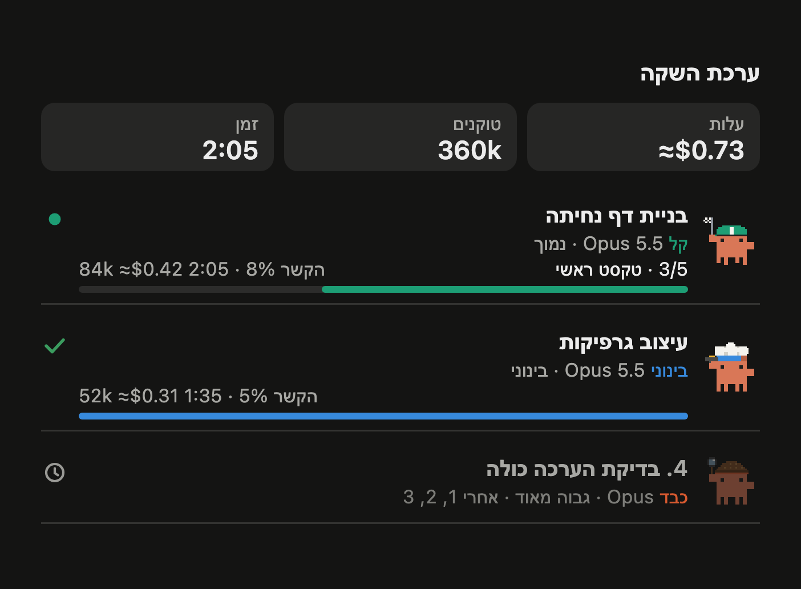

<div dir="rtl">

# claude-kit בעברית

גרסה עברית, מימין לשמאל, של [claude-kit](https://github.com/johnnyvizz/claude-kit) מאת johnnyvizz: בר התקדמות מעל שורת הכתיבה וחלונית חיה של הסוכנים העוזרים ב־Claude Code.





## מה יש כאן

| חבילה | סוג | מה היא עושה |
| --- | --- | --- |
| savvy-progress | מוד | בר התקדמות מעל שורת הכתיבה וחלונית סוכנים: מי עובד עכשיו, מה הסתיים ומה מתוכנן, עם מודל, התקדמות, עלות משוערת וזמן. בגרסה הזו הכל בעברית ומימין לשמאל. |
| savvy-flow | מיומנות וסוכנים | `/savvy-flow <משימה>`: המודל הראשי מתכנן, מחלק את העבודה לסוכנים עוזרים בחמש דרגות (קל, בינוני, זהיר, כבד, פייבל) ובודק את מה שהם עשו. |

שתי החבילות עובדות לבד, ויחד הן משלימות זו את זו: `/savvy-flow` מזיז את הבר, והסוכנים מדווחים לחלונית על ההתקדמות שלהם.

## התקנה

ב־Claude Code, בטרמינל:

```
/plugin marketplace add Elalouf2024/claude-kit-he
/plugin install savvy-progress@claude-kit-he
/plugin install savvy-flow@claude-kit-he
```

אחר כך פותחים שיחה חדשה. `/agents-info` פותח וסוגר את חלונית הסוכנים.

## מה השתנה לעומת המקור

- שפה עברית מלאה: הבר, החלונית, דרגות הסוכנים ורמות המאמץ.
- פריסה מימין לשמאל: הכותרת מימין, הבר מתמלא מימין לשמאל, והסרטן פונה שמאלה.
- עברית היא שפת ברירת המחדל. אפשר לעבור לאנגלית או לרוסית בהגדרה `language`.

כל השאר, וכל הקרדיט על הרעיון, העיצוב והקוד, שייכים ל־[johnnyvizz](https://github.com/johnnyvizz). רישיון MIT, ראו [LICENSE](LICENSE).

</div>
